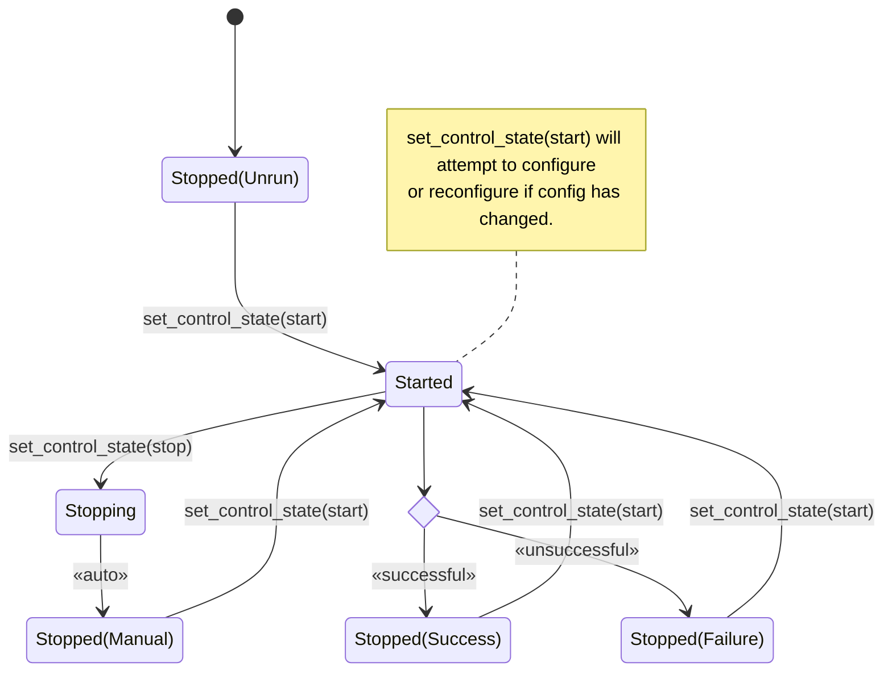

# AI Workload State Diagram

Simplified run state diagram for the collective benchmark. See the state
transitions table in
[result/collective_communications.yaml](../result/collective_communications.yaml)
for the complete set of transitions.

